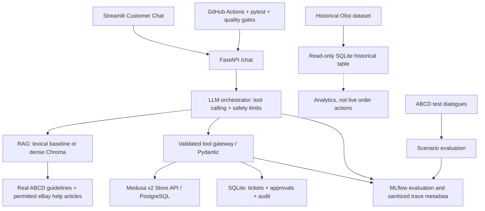

# CommerceOps AI — état local vérifié

## Synthèse RAG et formats — dernière correction

Le suivi « résume cette procédure en trois étapes » conserve désormais la demande exacte et produit trois étapes numérotées, avec les informations concrètes réellement retrouvées : éligibilité du scénario, étiquette après acceptation et modes cités par ABCD. Les formats court et détaillé ont un rendu distinct. Une étape dont l'extrait ou la condition manque n'est pas inventée. NVIDIA sélectionne les faits ; le backend compose un texte français contrôlé, avec citation et portée ABCD explicites.

**116 tests passent**, Ruff au profil CI et les deux quality gates passent. [Diagnostic, réponses réelles avant/après et audit de chaque étape](docs/RAG_SYNTHESIS_FORMATS.md). Panier, authentification et interface sont préservés ; aucun nouvel acte commercial n'a été exécuté pour ces vérifications. Le jeu final gelé n'est pas utilisé. Les sections suivantes conservent l'état des interventions précédentes.

## Correction globale V2 — état courant

L'interface présente des cartes produit/panier et des confirmations lisibles, sans JSON ni identifiants techniques par défaut. Après création confirmée, « mon panier » consulte réellement Medusa avec contrôle de propriété. Le volet développeur est facultatif. Les demandes documentaires utilisent une recherche déterministe et des faits français liés à des extraits vérifiés ; ABCD reste une référence de recherche, jamais une politique commerciale de la boutique.

**104 tests passent**, Ruff au profil CI, secrets et deux quality gates passent. Le parcours réel Streamlit/AppTest → FastAPI → Medusa a créé puis relu un panier de Sweatshirt M (quantité 1, montant réel 10 EUR), avec annulation, refus 409/404 et reset vérifiés. Quatre questions de la vraie UI ont utilisé NVIDIA. Sur 10 questions de développement connues, Recall@5 documentaire 10/10 contre 4/10 pour les chunks enrichis ; **aucune généralisation ni fidélité humaine indépendante déclarée**. Le jeu final reste gelé et non utilisé.

[Causes, corrections, mesures et limites V2](docs/RAG_AND_CART_FIXES.md) · [État de livraison](docs/IMPLEMENTATION_STATUS.md) · [Preuve du parcours réel](reports/global-v2/live.json). Le navigateur n'a pas été contrôlé visuellement ; AppTest teste le script réel et ses requêtes. Les sections suivantes conservent l'historique des interventions antérieures.

## Mémoire de conversation et panier

Le parcours « Medusa Sweatshirt taille M → Oui » conserve désormais le produit, la variante et la quantité côté backend dans une session opaque liée au client Medusa. Le « oui » prépare uniquement une approbation ; l'interface affiche ses arguments exacts et demande une case puis un bouton de confirmation. Un panier n'est annoncé créé qu'après la réponse de l'API métier. Le stock reste indiqué comme non vérifié. [Architecture, confidentialité, tests et limites](docs/CONVERSATION_MEMORY.md).

88 tests hors ligne passent. Le parcours réel du script Streamlit, piloté par AppTest vers FastAPI et Medusa sans mocks, a créé un panier local explicitement confirmé ; aucune nouvelle commande n'a été créée. Preuves : [rapport réel](reports/conversations/live-streamlit-medusa.json) et [contrôles](reports/conversations/checks.json). Ce test ne valide pas le rendu d'un navigateur ni la fidélité humaine du résumé RAG.

## Mise à jour RAG

Ingestion documentaire multi-format, index versionné à publication atomique et rechargement sans cache obsolète après reconstruction : voir [procédure et résultats](docs/RAG_UPDATES.md). Le lecteur actif utilise le candidat lexical avec métadonnées (55 documents, 217 passages) ; la baseline de 205 passages est préservée. Hybride disponible en option, sans gain supplémentaire établi par rapport au lexical enrichi sur les 12 cas connus. 73 tests passent ; Medusa et ses contrôles de sécurité sont inchangés. Un nouveau test final de 16 cas est gelé et non exécuté ; aucune généralisation ni fidélité humaine n'est déclarée comme validée.

## Audit de livraison du 12 novembre 2026

**Livraison PARTIAL**, même si le parcours local historique fonctionne. État courant : [IMPLEMENTATION_STATUS](docs/IMPLEMENTATION_STATUS.md). Rotation NVIDIA confirmée par l'utilisateur et lecture sûre vérifiée ; 42 tests repassés sous Python 3.14 et dans un environnement Docker Python 3.12 propre. Rapport exporté en PDF de 10 pages dans `output/pdf/`. Nouveau jeu distinct de 16 cas gelé, mais revue humaine non attestée : les mesures provisoires 1/5 lexical et 2/5 dense ne sont pas une validation indépendante. Succès de tâche indépendant : non évalué, n=0. Vidéo et captures Admin à enregistrer manuellement. La publication/CI ne sera déclarée réussie qu'avec un lien de run observé.

Les sections suivantes relatent l'implémentation et les mesures guidées antérieures. Pour la remise, la matrice COMPLETE/PARTIAL/BLOCKED ci-dessus et dans le statut fait foi.

**11 novembre 2026 : parcours local FONCTIONNEL DE BOUT EN BOUT.** NVIDIA → outils RAG/Medusa → confirmation → commande sandbox persistante → ticket → audit ont été exécutés. Un retour réel sans remboursement a aussi été créé. Vidéo, CI distante et collecte eBay restent non réalisés.

Preuves : [état détaillé](docs/IMPLEMENTATION_STATUS.md), [évaluation mesurée](reports/evaluation.json), [checkout Medusa](reports/medusa-smoke.json), [santé HTTP](reports/http-smoke.json), [reproductibilité](docs/REPRODUCIBILITY.md).

## Démarrage sur cette machine (PowerShell)

Depuis `commerceops_ai/`, Docker Desktop démarré, exécuter dans des terminaux séparés :

```powershell
.\scripts\start.cmd infra
.\scripts\start.cmd medusa
.\scripts\start.cmd api
.\scripts\start.cmd ui
.\scripts\start.cmd mlflow
.\scripts\start.cmd check
```

L’API est sur http://127.0.0.1:8001/docs ; Streamlit http://127.0.0.1:8501 ; Medusa http://localhost:9000/app ; MLflow http://127.0.0.1:5000. Le storefront optionnel n’est pas lancé. Les identifiants Admin locaux sont dans `../my-medusa-store/apps/backend/.env.admin` ignoré. Ne pas les publier. L’UI dispose d’une recherche documentaire directe fonctionnant sans LLM.

Installer sur une nouvelle machine : `python -m venv .venv`, puis `.\.venv\Scripts\python.exe -m pip install -r requirements-dev.txt mlflow`. Copier `.env.example` vers `.env` seulement s’il n’existe pas. Pour Linux, utiliser `.venv/bin/python` ; voir la procédure complète de reproductibilité. Le lock Windows/Python 3.14 fourni décrit uniquement l’environnement testé.

Fournisseur choisi : NVIDIA, endpoint `https://integrate.api.nvidia.com/v1`, modèle `nvidia/nemotron-3.5-lightning-30b-a3b`. Renseigner `LLM_API_KEY` localement et relancer l’API. Ne jamais coller la clé dans une conversation ou un rapport. Les instructions Groq conservées plus bas décrivent l’alternative historique du starter.

## Résultats observés

- 42 tests hors ligne réussis ; lint de sécurité et gate mesuré passent. GitHub Actions distant non exécuté.
- ABCD authentique : 55 documents, **205 passages actifs (90 mots, chevauchement 20)** ; 100 prompts de dialogues séparés, labels heuristiques.
- Comparaison réelle : Recall@5 8/12 (90 mots), 6/12 (180 mots), annotations agent **non validées humainement**. Latences à chaud et IDs MLflow dans le rapport JSON. La pertinence reste limitée.
- Medusa 2.22.6 : quatre produits, deux clients, vrai checkout `pp_system_default`, refus des commandes/paniers étrangers et retours directs non autorisés. Aucun transfert financier.
- Retours fermés dans les modèles, activés sur cette boutique de test : un retour autorisé persisté et refus 401/403 vérifiés. Olist : 99 441 lignes historiques. Chroma construit et testé (Recall@5 6/12), lexical conservé (8/12). eBay non collecté.

Vérifier : `.\.venv\Scripts\python.exe -m pytest tests -q`, puis `-m ruff check app tests scripts --select E4,E7,E9,F63,F7,F82`, `-m scripts.check_secrets`, `-m scripts.quality_gate`. Reproduire la comparaison avec `-m scripts.benchmark` ; la baseline n’est remplacée qu’avec `--record-baseline`, à utiliser après revue explicite. `scripts.evaluate` écrit séparément `reports/scenario-evaluation.json` et ne remplace plus les mesures RAG.

Le script `-m scripts.smoke_medusa` crée une NOUVELLE commande de démonstration à chaque exécution ; il est réservé à la boutique locale de test. Intégration Medusa et correctifs serveur : [integrations/medusa](integrations/medusa/README.md). Les fichiers historiques du starter ci-dessous fournissent le contexte ; l’état mesuré ci-dessus et IMPLEMENTATION_STATUS font foi.

---

# CommerceOps AI — Agentic customer support with real sources and a real e-commerce backend

**Projet 3 (ENSAF/ISDIA3), MLOps : orchestration d'outils, observabilité et gouvernance**.

This repository is an independently operated academic prototype; it is **not** an eBay, Olist, or ASAPP application. The project runs a real service, real persistent support tickets, and connects to an actual **Medusa v2** e-commerce instance. No synthetic FAQ or invented e-commerce history is bundled. External data are downloaded from their genuine publishers by the student.

## Sources (keep their roles distinct)

| Source | What it really provides | Use here |
|---|---|---|
| [eBay Help Center](https://www.ebay.com/help/buying) | Large set of public eBay help/policy articles | Optional third-party RAG corpus, subject to robots.txt, site terms, and permitted reuse |
| [ABCD, ASAPP Research](https://github.com/asappresearch/abcd) | >10k research customer-service dialogues and task guidelines | Real research guidelines for RAG; real dialogues for test prompts (not real production customer logs) |
| [Olist on Kaggle](https://www.kaggle.com/datasets/olistbr/brazilian-ecommerce) | ~100k anonymized **historical** order records (2016–2018) | Read-only historical analytics/test data, never active orders |
| [Medusa v2](https://docs.medusajs.com/) | Real product, cart, order, checkout, and return workflows | Live customer-facing transaction engine for our demo boutique |

**Important:** eBay policies are only external documentary references, never binding policies for our Medusa demonstration shop. ABCD research guidelines are scenario descriptions, not a company's production playbook. Refunds require business authorization in Medusa Admin; the LLM cannot move money. Olist customer IDs do not confer access to Medusa orders.

## Architecture



## 0. Prerequisites

- Windows + WSL Ubuntu, Git, Python **3.11–3.12** recommended, `venv`.
- Internet during setup to download publicly available source files and the embedding model.
- A local **Medusa v2 Store API** running and configured with products, region, sales channel, publishable key and a customer account.
- LLM API key for tool-calling (Groq OpenAI-compatible API or compatible local proxy), or Ollama adapted to the OpenAI-compatible chat-tools contract.
- Optional Docker for running Medusa; Docker is optional in the academic requirements.

## 1. Install the agent (WSL/Linux)

```bash
cd commerceops_ai
python3 -m venv .venv
source .venv/bin/activate
pip install -r requirements.txt
pip install pytest
cp .env.example .env
python -m pytest tests -q
```

Install the full MLOps tools if your machine has enough memory:

```bash
pip install -r requirements-mlops.txt
```

## 2. Download the actual documentary sources (NOT autogenerated)

**ABCD:**

```bash
python -m scripts.collect_real_sources --abcd
```

This downloads the official guidelines, knowledge base, ontology and 10k+ conversation dataset from the ASAPP repository. It converts guideline subflows into independently referenced knowledge documents. Conversation prompts remain **separate** from the RAG corpus to avoid evaluation leakage.

**eBay Help Center (optional; review reuse rights first):** `robots.txt` and website terms/permissions must be respected. The crawler intentionally refuses to run unless you explicitly enable collection after review. It does not bypass anti-bot controls.

```bash
# Only if collection is authorized and compliant with eBay terms:
export ALLOW_EBAY_COLLECTION=true
python -m scripts.collect_real_sources --ebay --max-pages 150
```

If you do not have permission for automatic collection, use the **ABCD official guidelines**, plus locally approved documents in `data/knowledge/`, with each file in the form `{ "source": "actual URL", "title": "...", "source_type": "approved", "text": "actual content" }`. Do not invent documents, permissions or provenance.

Build the RAG index:

```bash
# Fast reproducible TF-IDF baseline:
python -m scripts.build_index --backend lexical
# Better semantic retrieval: requires requirements-mlops, embedding download, and more RAM:
python -m scripts.build_index --backend chroma
# Set RAG_BACKEND=chroma in .env after successful dense indexing
```

This comparison is useful for an **MLOps experiment**: both use the same real corpus and versioned chunk manifest. The dense model is multilingual, suitable for French client messages and English source documents. Record chunk size, overlap, corpus hash and embedding model as experiment parameters.

## 3. Download Olist (real historic dataset)

Get the dataset from the **original** Kaggle page and extract its CSVs to `data/raw/olist/`:

https://www.kaggle.com/datasets/olistbr/brazilian-ecommerce

```bash
python -m scripts.import_olist
```

This will import about 99,442 historical order rows if the published dataset is complete. It deliberately **does not** import these historical orders into active Medusa orders, which would misrepresent historical transactions. Use them for read-only analytics, performance scenarios or synthetic test case **construction with disclosure**.

Olist license: CC BY-NC-SA 4.0 (check upstream). ABCD repo: MIT (check upstream). Reproduce from the original source; keep dataset versions and SHA256 hashes.

## 4. Install your real Medusa e-commerce shop

Follow the **official** guide (Medusa 2.22 documentation):

https://docs.medusajs.com/learn/installation/docker

Docker-based setup uses the DTC starter, PostgreSQL, Redis, Medusa backend/admin and optional storefront. The setup must be done in a **separate** folder from this Python repository:

```bash
cd ..
git clone https://github.com/medusajs/dtc-starter.git --depth=1 my-medusa-store
cd my-medusa-store
# Follow the complete official Docker configuration guide before docker compose up.
```

Medusa Admin: `http://localhost:9000/app`; Store API: `http://localhost:9000/store`.

The storefront's port depends on your starter setup. Use it to register/login a test customer, choose address, shipping and test payment (the agent cannot provide a payment form securely).

Create a **test** region, products/variants, sales channel + publishable API key in the Medusa Admin. Copy the publishable key and region ID to **your local** `.env`:

```env
MEDUSA_URL=http://localhost:9000
MEDUSA_PUBLISHABLE_KEY=pk_...   # example only, obtain from your local Medusa
MEDUSA_REGION_ID=reg_...       # example only
LLM_API_KEY=...                # never commit
RAG_BACKEND=lexical
```

Important: **store** API and **admin** API have separate authorization scopes. The agent only uses the Store API and customer JWT; refunds/money management are manually approved in Medusa Admin. Order access is checked against the authenticated Medusa customer ID.

## 5. Start the real agent API and UI

```bash
# From commerceops_ai/ and with the .venv activated:
uvicorn app.api:api --host 127.0.0.1 --port 8001 --reload
```

- Swagger API: http://localhost:8001/docs
- Health check: http://localhost:8001/health
- Retrieval test: POST http://localhost:8001/knowledge/search
- Monitoring metrics: http://localhost:8001/metrics

In another terminal (with optional `streamlit` installed):

```bash
streamlit run app/ui.py --server.port 8501
```

Open http://localhost:8501. In the sidebar, set API URL to `http://localhost:8001` and paste the **customer Medusa JWT** when testing user-owned orders. Keep it out of commits/screenshots; use a local demo customer account.

Supported agent tools:

1. `search_knowledge` — real indexed documentation with URLs and metadata.
2. `search_products` — real Medusa catalog.
3. `list_orders` — only the authenticated Medusa customer.
4. `get_order_status` — order ownership checked.
5. `prepare_cart` — PENDING customer approval, then real Medusa cart creation.
6. `request_checkout` — PENDING approval, then real Medusa cart completion if delivery/payment fully set.
7. `request_return` — PENDING approval, Medusa return request after ownership check and explicit local store eligibility checks.
8. `create_ticket` — persists a real ticket in SQLite with customer ownership.

**Approvals:** the LLM cannot set the user's consent. It generates an `appr_...` ID. The logged-in customer then explicitly confirms it via UI or `POST /actions/confirm`. Unconfirmed actions never execute. Failed confirmations are marked failed, never silently retried to avoid duplicate writes.

**What the agent doesn't do:** make financial refunds directly, read foreign orders, override merchant stock/prices, use production admin credentials, or claim that eBay policies govern this boutique. A successful checkout depends on an existing configured Medusa payment/shipping flow.

## 6. Evaluate, version and monitor

```bash
# Review actual ABCD prompts and build a reproducible scenario subset
python -m scripts.build_abcd_eval
# Run tests without any external services
python -m pytest tests -q
# Real results, if the necessary sources, gold labels and API key are present
python -m scripts.evaluate
python -m scripts.evaluate --agent --limit 20
# Run MLflow local UI after installing MLflow
mlflow ui --backend-store-uri ./mlruns --port 5000
```

To measure `Recall@5`, create `data/evaluation/retrieval_gold.jsonl` with **human-validated real relevance labels**:

```json
{"question":"How can a buyer request a return?","relevant_source":"https://www.ebay.com/help/buying/returns-refunds/return-item-refund?id=4041"}
```

This is an illustrative *annotation format*, not a score or a synthetic knowledge-base article. Expected sources must match the indexed `source` values. Quality gates must use measured baselines and justified allowed regressions (copy/edit `docs/quality_baseline.example.json` to `docs/quality_baseline.json`). If results or baseline are absent, the gate **fails closed**.

```bash
python -m scripts.quality_gate --results reports/evaluation.json --baseline docs/quality_baseline.json
```

Logs in the SQLite `audit_events` table contain only request ID, tool name, category, success, duration and error class. They **do not** log prompts, customer JWTs or full tool results. MLflow logs evaluation experiment parameters/metrics/artifacts. For richer trace dashboards, see `docs/NEXT_STEPS.md`.

## 7. What is validated and what is not

**État historique du ZIP :** 9 tests isolés. Voir en tête les vérifications supplémentaires réellement exécutées sur cette machine.

**Encore non réalisé :** collecte eBay, CI distante, vidéo, revue humaine des annotations et mise en page finale du rapport. Olist, dense, NVIDIA et retour autorisé ont été exécutés (voir rapports locaux).

## 8. Required academic deliverables mapping

- GitHub code/config/tests/CI: this repository and `.github/workflows/ci.yml`.
- README: this file.
- 8–12-page technical report: plan in `docs/RAPPORT_PLAN.md`, fill with measured results.
- Reproducibility: `docs/REPRODUCIBILITY.md`, `.env.example`, SHA256 script and source versions.
- Evaluation: `scripts/evaluate.py`, annotated gold file, MLflow and actual score report.
- 2-min demonstration: scene guide in `docs/DEMO_2MIN.md` after live startup.
- Ethics/governance: `docs/RISKS_AND_GOVERNANCE.md`.
- No private data/keys in Git. Verify `.gitignore` and CI.


## Validation NVIDIA et P1

Six scénarios guidés : bons outils 6/6, un appel moyen, latence moyenne 4 285 ms. [Parcours réel](reports/agent-live.json), [refus réels](reports/agent-negative.json), [retour persistant](reports/return-smoke.json), [Olist](reports/olist-import.json), [dense](reports/dense-evaluation.json). Ce petit jeu de développement ne remplace pas une évaluation indépendante. Le modèle actif est `nvidia/nemotron-3.5-lightning-30b-a3b` ; Llama 3.3 est retiré de l’endpoint. Aucun remboursement financier n’a été effectué.

La clé saisie initialement dans `.env.example` a été déplacée et l’exemple nettoyé. Elle doit être remplacée depuis NVIDIA car elle est apparue dans une sortie technique. Aucun commit ni push n’a été effectué.
